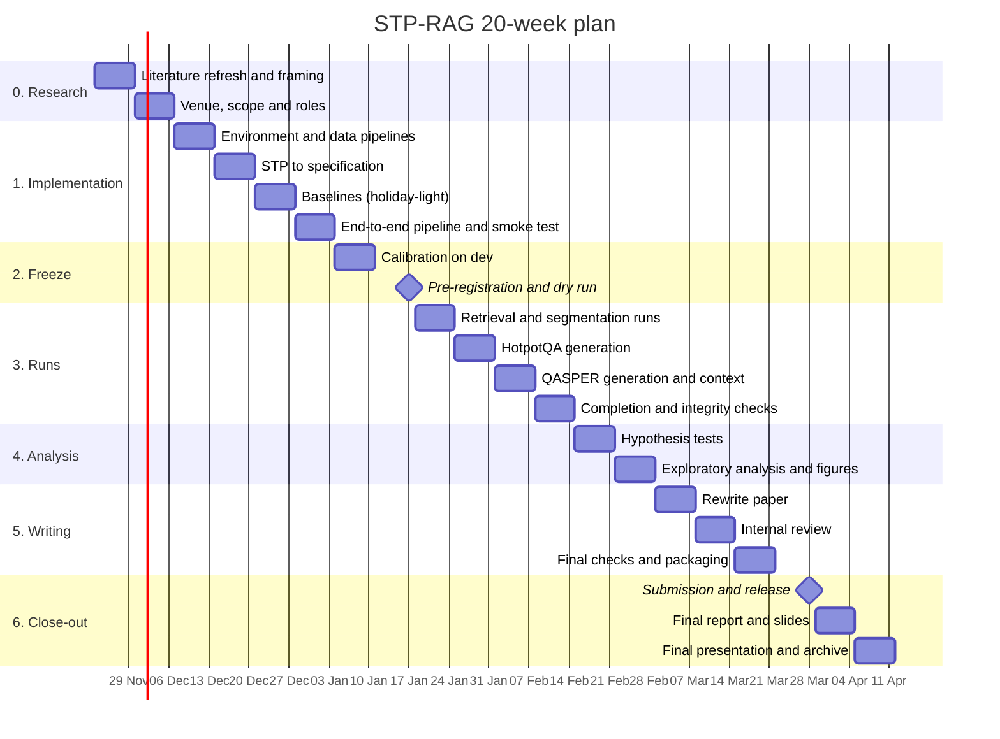

# STP-RAG: 20-Week Project and Paper Plan

**Project:** STP-RAG, semantic transition profile-guided adaptive chunking and selective context for retrieval-augmented generation
**Team:** Mohammad Sameer, Rajeev Kumar Gupta, Mohit Dev Tomar, Dharm Raj, Parma Nand, Rani Astya (Sharda University)
**Plan period:** Week 1 starts Monday 23 November 2026; Week 20 ends Sunday 11 April 2027
**Outcome:** a confirmatory experiment, a submitted paper, released code and data, and the final project presentation

---

## Contents

1. [Where the project stands](#1-where-the-project-stands)
2. [Goals and success criteria](#2-goals-and-success-criteria)
3. [Phases at a glance](#3-phases-at-a-glance)
4. [Timeline chart](#4-timeline-chart)
5. [Week-by-week plan](#5-week-by-week-plan)
6. [Milestones and review gates](#6-milestones-and-review-gates)
7. [Roles](#7-roles)
8. [Compute and cost planning](#8-compute-and-cost-planning)
9. [Risks and mitigations](#9-risks-and-mitigations)
10. [Working rhythm](#10-working-rhythm)
11. [Definition of done](#11-definition-of-done)
12. [Key files](#12-key-files)

---

## 1. Where the project stands

The plan starts from what already exists, so early weeks refresh and extend that work rather than start from nothing.

| Area | Status on 20 November 2026 | Location |
| --- | --- | --- |
| Reference specification (Eqs. 1–9, Algorithm 1) | Complete | `paper/STP_RAG_Research_Paper_v2_full.tex` |
| Audit of the pilot | Complete; 13-component reconciliation | Same file, Section 4 |
| Confirmatory protocol and hypotheses H1–H4 | Written, not yet run | Same file, Section 5 |
| Six-page conference paper | Complete for the pilot; results section must be replaced after the confirmatory run | `paper/STP_RAG_Research_Paper_v2.tex` |
| Evaluation harness (`stp_eval`) | Metrics, statistics, records, report CLI; 27 unit tests pass | `stp_eval_harness/` |
| Dashboard | Playground, Try it, How STP works, Evidence pages; loads a real `run_bundle.json` | `dashboard/` |
| Paper Orchestra draft | 10-page working draft, numbers verified | `paper_orchestra/output/final_paper_corrected.pdf` |
| Confirmatory experiment | **Not started.** This is the main work of the plan. | — |

**The main gap:** every result reported so far comes from a pilot that the audit showed is confounded. It used unequal prompt budgets, scored only 25 generated answers per dataset, dropped 42 of 149 QASPER questions, and its velocity-only baseline still carried structural weighting. The paper cannot make a confirmatory claim until the protocol in Section 5 of the paper has been run.

---

## 2. Goals and success criteria

| # | Goal | Measured by | Target week |
| --- | --- | --- | --- |
| G1 | Implement STP-RAG and all baselines exactly as specified | Parity tests against the reference; every pilot deviation in the audit table closed | Week 6 |
| G2 | Freeze the protocol before seeing test results | Timestamped pre-registration and a manifest with SHA-256 checksums | Week 8 |
| G3 | Run the confirmatory experiment in full | Per-query JSONL records for every arm, dataset and budget; no answerable question dropped | Week 12 |
| G4 | Test H1–H4 with the planned statistics | Paired and clustered bootstrap intervals, sign-flip tests, Holm-corrected decisions | Week 13 |
| G5 | Submit the paper | Submission receipt from the chosen venue; preprint posted if the venue allows | Week 18 |
| G6 | Release the work | Public repository and archived release with a DOI; dashboard updated with real results | Week 18 |
| G7 | Close the project | Final report, final presentation and handover archive | Week 20 |

A result counts as success whatever direction it goes. If H1–H4 are not supported, the paper reports that clearly; the contribution is the controlled test, not a guaranteed win.

---

## 3. Phases at a glance

| Phase | Weeks | Dates | Focus | Exit gate |
| --- | --- | --- | --- | --- |
| 0. Research foundations | 1–2 | 23 Nov – 6 Dec | Literature refresh, venue choice, roles | G0: scope and venue agreed |
| 1. Implementation | 3–6 | 7 Dec – 3 Jan | Pinned environment, data, STP to spec, baselines, end-to-end pipeline | G1: implementation passes parity and smoke tests |
| 2. Calibration and pre-registration | 7–8 | 4 Jan – 17 Jan | Calibrate on dev only, then freeze everything | G2: protocol frozen and registered |
| 3. Confirmatory runs | 9–12 | 18 Jan – 14 Feb | Retrieval, segmentation and generation runs | G3: complete, validated records |
| 4. Analysis | 13–14 | 15 Feb – 28 Feb | Hypothesis tests, exploratory analysis, figures | G4: results signed off |
| 5. Writing and review | 15–17 | 1 Mar – 21 Mar | Rewrite both paper versions, internal review, checks | G5: paper approved for submission |
| 6. Submission and close-out | 18–20 | 22 Mar – 11 Apr | Submit, release, report, final presentation | G6: project closed |

Weeks 5 and 6 fall over the winter holidays. They carry lighter, self-contained tasks, and the plan treats them as partial buffer.

---

## 4. Timeline chart

---

## 5. Week-by-week plan

Each week lists its goal, tasks, deliverables and a check that must pass before moving on. Owners are roles from [Section 7](#7-roles); assign names in Week 1.

### Phase 0: Research foundations

#### Week 1 · 23–29 November 2026 · Literature refresh and problem framing

**Goal:** confirm the research question still holds against work published since the related-work section was written.

- [ ] Search 2025–2026 work on adaptive chunking, semantic chunking cost, late chunking and RAG evaluation (Research lead)
- [ ] Read and summarise the new papers found by the Paper Orchestra run, starting with *Is Semantic Chunking Worth the Computational Cost?* and *RAGChecker*
- [ ] Update the related-work matrix: for each paper, record method, datasets, budget control and the gap it leaves
- [ ] Restate RQ1–RQ3 in one paragraph each and check that H1–H4 still answer them
- [ ] Hold the kick-off meeting; assign every role in Section 7

**Deliverables:** updated related-work matrix; one-page problem statement; role assignments.
**Check:** every new paper that competes directly with STP-RAG is either cited or recorded as out of scope with a reason.

#### Week 2 · 30 November – 6 December 2026 · Scope, venue and data access

**Goal:** lock what will be built, where it will be submitted, and confirm the data is usable.

- [ ] Shortlist three venues; record page limit, template, anonymity rules and deadline for each (Writing lead)
- [ ] Choose the target venue and a fallback; enter both deadlines in the [milestones table](#6-milestones-and-review-gates)
- [ ] Download HotpotQA (distractor setting) and QASPER; record versions, licences and checksums (Data lead)
- [ ] Confirm the QASPER test split size and the official evaluator script
- [ ] Decide context placement for the main runs (branch A or B) and record the decision
- [ ] Set up the shared repository structure, branch rules and the weekly meeting

**Deliverables:** venue decision memo; data inventory with checksums; placement decision.
**Gate G0:** scope, venue and roles agreed by all six authors.

### Phase 1: Implementation

#### Week 3 · 7–13 December 2026 · Pinned environment and data pipelines

**Goal:** make every run reproducible from a manifest, and get both datasets into the evaluation format.

- [ ] Pin the encoder: `BAAI/bge-small-en-v1.5` at a fixed revision; one encoder everywhere (closes the audit's encoder conflict)
- [ ] Pin the generator: `phi3:mini` with a recorded digest and quantisation; temperature 0, 64 new tokens
- [ ] Lock Python dependencies; record hardware for latency reporting
- [ ] Build the HotpotQA sample: 1,000 distractor-setting questions stratified equally between bridge and comparison types, with one shared index
- [ ] Build the QASPER pipeline over the full test split
- [ ] Implement span alignment: exact lookup with a token-overlap fallback (Jaccard ≥ 0.7); report every unresolved question
- [ ] Estimate compute from the actual question counts ([Section 8](#8-compute-and-cost-planning))

**Deliverables:** `manifest.yaml` draft; processed datasets; alignment report.
**Check:** alignment drops no answerable question, against 28.2% dropped in the pilot.

#### Week 4 · 14–20 December 2026 · STP implemented to specification

**Goal:** a production implementation that matches the reference specification and the harness.

- [ ] Implement the profile (Eqs. 1–5), including the IQR → 1.4826·MAD → SD → 1 fallback, with a count of how often each fallback fires
- [ ] Implement bounded segmentation (Algorithm 1, Eq. 7) with ties going to the later position
- [ ] Implement profile-guided context (Eqs. 8–9) with **both** predecessor and successor candidates, and the relevance-only control (λ_t = 0, fixed horizon)
- [ ] Use a binary five-flag structure vector, not the pilot's scalar score
- [ ] Add parity tests against `stp_eval` on fixed inputs, as the dashboard already does
- [ ] Tick off each "Differs", "Conflict" or "Unverified" row of the audit table

**Deliverables:** STP module with tests; audit-closure checklist.
**Check:** parity tests pass; every audit row is closed or has a written reason.

#### Week 5 · 21–27 December 2026 · Baselines (holiday-light week)

**Goal:** every comparison arm runs on the same encoder, index and budgets.

- [ ] Fixed-size chunking at 100, 250 and 400 tokens, plus the length matched to full STP's mean chunk length
- [ ] Similarity threshold, and the percentile semantic splitter at the 95th percentile of adjacent cosine distance
- [ ] Recursive heading-and-paragraph splitter
- [ ] TextTiling and C99
- [ ] Supervised segmenter, if its training data permit; otherwise record why it is excluded
- [ ] Factorial STP arms: structure only, velocity only, velocity + structure, acceleration only, volatility only, kinematics only, full boundary with fixed target, full STP

**Deliverables:** all arms runnable from one config file.
**Check:** each arm produces chunks with offsets for 10 documents per dataset.

#### Week 6 · 28 December 2026 – 3 January 2027 · End-to-end pipeline and smoke test

**Goal:** one command runs any cell of the design and writes harness records.

- [ ] Build the index, retrieval and budget packing into 512, 1,024 and 2,048 prompt tokens, truncating at a unit boundary
- [ ] Fix the prompt template; record its checksum
- [ ] Write one JSONL record per query and arm, with ranked chunks, attached context and its provenance, the exact prompt and its token count, and the raw and normalised answers
- [ ] Run 20 development questions per dataset through every arm
- [ ] Load the resulting bundle into the dashboard's Evidence page as a visual check

**Deliverables:** runnable pipeline; smoke-test bundle.
**Gate G1:** smoke test passes for every arm, budget and context policy; harness tests pass.

### Phase 2: Calibration and pre-registration

#### Week 7 · 4–10 January 2027 · Calibration on the development split

**Goal:** fit the only learned parts of STP without touching test data.

- [ ] Calibrate the boundary weights with Optuna: 200 trials, objective dev Recall@1024 tokens
- [ ] Fit robust scalers on the development split only; log fallback counts
- [ ] Freeze the reference values (τ_b = 0.5, L_min/L_t/L_max = 64/192/384, γ = 0.5, H_max = 6, λ = 1/0.5/0.25/1/0.25, τ_r = 0.30, B_ctx = 192), or record any change with its reason
- [ ] Measure run time per question per cell; update the compute estimate

**Deliverables:** calibrated `stp_params.yaml`; calibration report.
**Check:** no test-split file was opened by any calibration script (verify from logs).

#### Week 8 · 11–17 January 2027 · Pre-registration and freeze

**Goal:** commit to the analysis before seeing any confirmatory result.

- [ ] Write the pre-registration: H1–H4 exactly as in the paper, the primary metric for each, the Holm family, the bootstrap and permutation settings (10,000 each), and the exclusion rules
- [ ] Register it with a timestamp on a public registry, for example OSF
- [ ] Finalise `manifest.yaml`: parameters, splits, model digests, prompt template, each with a SHA-256 checksum
- [ ] Dry-run `python3 -m stp_eval.report` on the dev bundle and check every table it produces

**Deliverables:** registered protocol; frozen manifest.
**Gate G2:** all six authors sign off. From here, any change is reported in the paper as a deviation.

### Phase 3: Confirmatory runs

#### Week 9 · 18–24 January 2027 · Retrieval and segmentation runs

**Goal:** the inexpensive half of the experiment, for every cell.

- [ ] Run retrieval for all arms × both datasets × three budgets
- [ ] Compute Recall@K, MRR@10, Recall@B tokens and the evidence split rate
- [ ] Compute P_k and WindowDiff against paragraph boundaries (HotpotQA) and section and paragraph boundaries (QASPER)
- [ ] Record index size, build time and retrieval latency: 20-query warm-up, five repetitions, timer around the vector search only

**Deliverables:** retrieval and segmentation records.
**Check:** record counts equal questions × cells; no missing rows.

#### Week 10 · 25–31 January 2027 · HotpotQA generation

**Goal:** answer generation for the cells the hypotheses need, on HotpotQA.

- [ ] Run the H1 cells first: full STP with profile-guided context against length-matched fixed-size chunking with relevance-only context, at B = 1,024
- [ ] Run the remaining generation cells in priority order ([Section 8](#8-compute-and-cost-planning))
- [ ] Score EM and token F1 with SQuAD normalisation
- [ ] Check progress daily against the compute estimate

**Deliverables:** HotpotQA generation records.
**Check:** H1 cells complete for all 1,000 questions.

#### Week 11 · 1–7 February 2027 · QASPER generation and context metrics

**Goal:** finish generation and measure what the context selector adds.

- [ ] Run QASPER generation in the same priority order; score with the official evaluator, including unanswerable questions
- [ ] Compute context precision and gold-recovery rate for profile-guided and relevance-only context on the same base chunks (H3)
- [ ] Repeat a fixed subset of cells to measure run-to-run generator variance separately from sampling uncertainty

**Deliverables:** QASPER generation records; context metrics.
**Check:** H3 inputs are complete on both datasets.

#### Week 12 · 8–14 February 2027 · Completion and integrity checks

**Goal:** a complete, verified dataset of results before any hypothesis is tested.

- [ ] Rerun any failed or missing cells
- [ ] Verify every record's checksums against the manifest
- [ ] Check prompt token counts never exceed their budget
- [ ] Build the final `run_bundle.json` with `stp_eval.report`
- [ ] Back up all raw records in two places

**Deliverables:** final run bundle; integrity report.
**Gate G3:** records complete and verified. The analysis lead confirms no hypothesis test has been run yet.

### Phase 4: Analysis

#### Week 13 · 15–21 February 2027 · Hypothesis tests

**Goal:** the pre-registered analysis, exactly as written.

- [ ] HotpotQA: paired bootstrap over queries; QASPER: resample whole papers with all of their questions
- [ ] Sign-flip permutation tests; Holm correction across H1–H4
- [ ] Write one decision per hypothesis: supported, not supported, or inconclusive, with effect size and interval
- [ ] List every deviation from the pre-registration

**Deliverables:** hypothesis results table; deviation log.
**Check:** a second team member reruns the analysis from the bundle and gets identical numbers.

#### Week 14 · 22–28 February 2027 · Exploratory analysis, figures and dashboard

**Goal:** explain the results, clearly separated from the confirmatory tests.

- [ ] Break down the context effect by evidence hops, evidence distance, cross-section evidence, document length, answerability and context length
- [ ] Plot F1 against prompt tokens and compute the area under the quality–budget curve
- [ ] Error analysis: 20 annotated examples where methods disagree
- [ ] Generate every table and figure from scripts, following the `make_results.py` pattern
- [ ] Load the real bundle into the dashboard's Evidence page and retire the pilot-only views

**Deliverables:** exploratory report; figure and table scripts; updated dashboard.
**Gate G4:** results reviewed and signed off by the faculty authors.

### Phase 5: Writing and review

#### Week 15 · 1–7 March 2027 · Rewrite the paper

**Goal:** both paper versions updated with confirmatory results.

- [ ] Replace the pilot results in the six-page paper with the confirmatory results; keep the audit as motivation
- [ ] Update the abstract, introduction, contributions and conclusion to match what the results support
- [ ] Update the full version for arXiv or a journal, with the factorial results and exploratory analysis
- [ ] Move to the venue's official template if it differs from IEEEtran

**Deliverables:** complete draft of both versions.
**Check:** every number in the text is generated from the bundle, none typed by hand.

#### Week 16 · 8–14 March 2027 · Internal review

**Goal:** catch problems before reviewers do.

- [ ] Each author reviews one assigned part, plus the whole paper once
- [ ] Run an independent reviewer-style critique: soundness, clarity, overclaiming, missing baselines
- [ ] Resolve every comment or record why it was declined
- [ ] Check claims against the hypothesis table: nothing stronger than the evidence

**Deliverables:** review log; revised draft.
**Check:** no open review comments.

#### Week 17 · 15–21 March 2027 · Final checks and packaging

**Goal:** a submission-ready paper and artifact.

- [ ] Verify every citation against its source; no unverified references
- [ ] Run plagiarism and AI-writing checks; rewrite any flagged passages
- [ ] Complete the venue's reproducibility checklist
- [ ] Package code, configs, manifest, records and figure scripts; test a clean install from scratch
- [ ] Prepare an anonymised version if the venue requires one

**Deliverables:** final PDF; artifact package.
**Gate G5:** all authors approve submission.

### Phase 6: Submission and close-out

#### Week 18 · 22–28 March 2027 · Submission and release

**Goal:** the paper is submitted and the work is public.

- [ ] Submit to the target venue
- [ ] Post the preprint, if the venue's policy allows
- [ ] Publish the repository; archive the release on Zenodo for a DOI
- [ ] Deploy the dashboard with the real results

**Deliverables:** submission receipt; public release with DOI.
**Milestone:** paper submitted.

#### Week 19 · 29 March – 4 April 2027 · Final report and presentation

**Goal:** the project documentation for the university evaluation.

- [ ] Write the final project report from the paper, the protocol and the implementation notes
- [ ] Build the final presentation; include a live dashboard demo with a backup recording
- [ ] Rehearse twice with timing; prepare answers to likely questions

**Deliverables:** final report; slides; demo recording.
**Check:** a full rehearsal finishes within the time limit.

#### Week 20 · 5–11 April 2027 · Final presentation and close-out

**Goal:** present the work and leave the project in a state anyone can pick up.

- [ ] Deliver the final presentation and viva
- [ ] Hold a team retrospective: what worked, what to change
- [ ] Write the reviewer-response plan for when the venue's reviews arrive
- [ ] Archive everything: data, records, manifest, paper sources, dashboard build, meeting notes

**Deliverables:** presentation delivered; retrospective notes; final archive.
**Gate G6:** project closed.

---

## 6. Milestones and review gates

| Gate | Week | Date | Pass condition | Approved by |
| --- | --- | --- | --- | --- |
| G0 Scope and venue | 2 | 6 Dec 2026 | Venue, scope and roles agreed | All authors |
| G1 Implementation | 6 | 3 Jan 2027 | Parity and smoke tests pass for every arm | Method lead, Evaluation lead |
| G2 Protocol frozen | 8 | 17 Jan 2027 | Pre-registration public; manifest checksummed | All authors |
| G3 Runs complete | 12 | 14 Feb 2027 | Complete, verified records; final bundle built | Evaluation lead |
| G4 Results signed off | 14 | 28 Feb 2027 | Analysis reproduced independently | Faculty authors |
| G5 Paper approved | 17 | 21 Mar 2027 | No open review comments; checks passed | All authors |
| G6 Project closed | 20 | 11 Apr 2027 | Presentation delivered; archive complete | Faculty authors |

**External dates (fill in during Week 2):**

| Item | Date | Notes |
| --- | --- | --- |
| Target venue submission deadline | _TBD_ | Must fall on or after Week 18. If earlier, move Phases 5–6 forward and shrink exploratory work. |
| Fallback venue deadline | _TBD_ | |
| University evaluations | _TBD_ | Align with Gates G2, G4 and G6 where possible. |

---

## 7. Roles

Assign one person per role in Week 1. One person can hold more than one role.

| Role | Responsibilities | Leads in weeks |
| --- | --- | --- |
| Project lead | Plan, weekly meeting, gate reviews, risk register | All |
| Research lead | Literature, related work, citation verification | 1–2, 17 |
| Data lead | Datasets, alignment, manifest checksums, backups | 2–3, 12 |
| Method lead | STP implementation, calibration, parity tests | 4, 6–7 |
| Baselines lead | All comparison arms | 5 |
| Evaluation lead | Runs, records, statistics, run bundle | 9–13 |
| Writing lead | Paper versions, templates, submission | 15–18 |
| Dashboard and demo lead | Dashboard updates, demo, presentation | 14, 19 |
| Faculty reviewers | Gate approvals, internal review, scientific sign-off | Gates, 16 |

---

## 8. Compute and cost planning

Retrieval is cheap; answer generation dominates the cost. The number of generation calls is:

> questions × segmentation arms × context policies × prompt budgets

With 1,000 HotpotQA questions plus the QASPER test split, running every arm under every context policy and budget would mean hundreds of thousands of local generator calls. Week 3 replaces this rough figure with real counts, and Week 7 with measured seconds per call.

**Priority order if time is short:**

1. **H1 cells (required):** full STP + profile-guided context and length-matched fixed-size + relevance-only context, at B = 1,024, on both datasets.
2. **H3 cells (required):** profile-guided against relevance-only context on the same full-STP base chunks.
3. **Remaining budgets** (512 and 2,048) for the H1 cells, for the quality–budget curves.
4. **Factorial and competitive arms** at B = 1,024.
5. **Everything else.**

H2 and H4 need retrieval metrics only, so they never wait on generation.

**Hosted model costs:** Paper Orchestra and any LLM-based review use OpenRouter credit. Set a monthly cap on the OpenRouter account before Week 15.

---

## 9. Risks and mitigations

| Risk | Likelihood | Impact | Mitigation |
| --- | --- | --- | --- |
| Generation takes longer than planned | High | High | Week 3 and 7 estimates; run cells in the priority order in Section 8; use spare machines overnight |
| Venue deadline falls before Week 18 | Medium | High | Decide the venue in Week 2; compress Phase 4 exploratory work first, never the confirmatory tests |
| Results do not support H1–H4 | Medium | Medium | Pre-registration makes a null result publishable; frame the paper around the controlled test and the audit |
| Test data touched during calibration | Low | High | Separate dev and test directories; scripts refuse test paths before Gate G2 |
| Span alignment still fails for some questions | Medium | Medium | Report every unresolved question with its count, as the protocol requires |
| Supervised segmenter cannot be trained | Medium | Low | Record the exclusion and its reason; the other competitive baselines remain |
| Model or library versions change mid-project | Medium | Medium | Pinned revisions and digests in the manifest; cache model files locally |
| Team availability over the holidays | High | Medium | Weeks 5–6 hold self-contained tasks and act as partial buffer |
| Data loss | Low | High | Records backed up in two places from Week 9 |
| Citation or plagiarism problems | Low | High | Week 17 verification of every reference; plagiarism and AI-writing checks |

---

## 10. Working rhythm

| When | What | Who |
| --- | --- | --- |
| Monday | 30-minute planning meeting: last week's check, this week's tasks | All authors |
| Wednesday | 15-minute progress check, blockers only | Active role leads |
| Friday | Push work, update the plan's checkboxes, note slips | Everyone |
| Each gate week | One-hour gate review against the pass condition | All authors |

**Rules:**

- A task that slips by more than one week is raised at the Monday meeting with a recovery plan.
- After Gate G2, no change to the protocol without a written deviation note.
- Every number in the paper comes from a script, never typed by hand.

---

## 11. Definition of done

The project is complete when all of the following are true:

- [ ] H1–H4 have been tested exactly as pre-registered, with every deviation reported
- [ ] Every query, arm, budget and context policy has a JSONL record, and the bundle reproduces every table and figure
- [ ] The paper is submitted, and its claims match the hypothesis decisions
- [ ] Code, configuration, manifest and records are public with a DOI
- [ ] The dashboard shows the confirmatory results
- [ ] The final report and presentation are delivered
- [ ] The archive lets a new team member rerun the experiment from the manifest

---

## 12. Key files

| File or folder | Purpose |
| --- | --- |
| `paper/STP_RAG_Research_Paper_v2.tex` | Six-page conference paper |
| `paper/STP_RAG_Research_Paper_v2_full.tex` | Full single-column version, including the confirmatory protocol |
| `paper/scripts/make_results.py` | Generates every results table and figure from data |
| `paper/REVISION_NOTES.md` | Record of paper revisions |
| `stp_eval_harness/` | Evaluation harness: metrics, statistics, records, report CLI |
| `dashboard/` | Interactive dashboard; the Evidence page loads `run_bundle.json` |
| `dashboard/HOW_TO_USE.md` | Dashboard guide |
| `paper_orchestra/output/final_paper_corrected.pdf` | Machine-drafted working paper, numbers verified |
| `presentation/` | Presentation sources from earlier evaluations |
